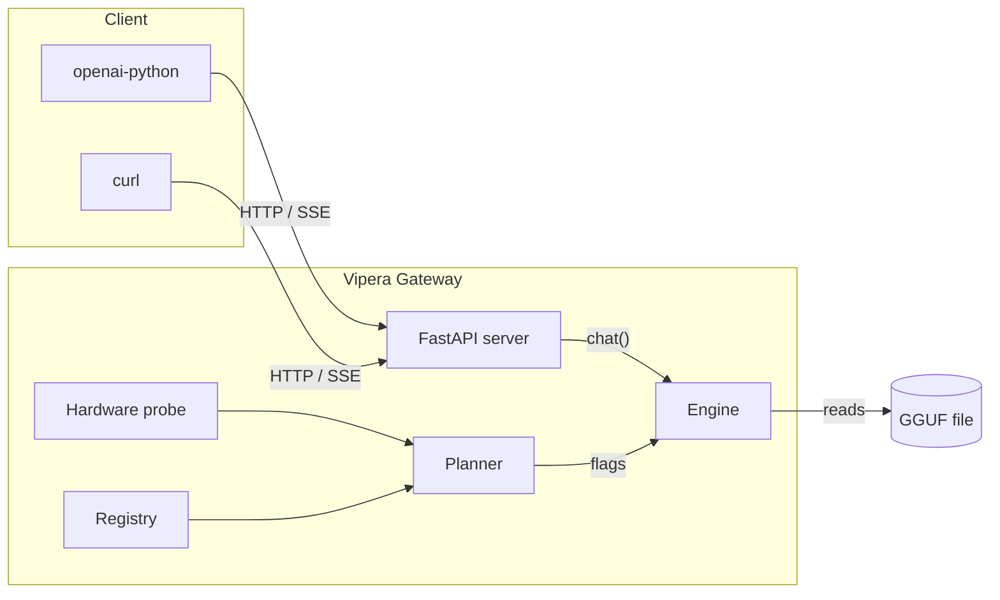

<div align="center">


# Vipera

**A local AI gateway that plans before it runs.**
One `.gguf` in, an OpenAI-compatible HTTP server out.

[](https://github.com/vipera-iso/vipera/actions/workflows/ci.yml)
[](https://github.com/vipera-iso/vipera/actions/workflows/docs.yml)
[](pyproject.toml)
[](LICENSE)
[](CHANGELOG.md)
[](CONTRIBUTING.md)

[Quick start](#quick-start) · [CLI](docs/cli.md) · [HTTP API](docs/http-api.md) · [Docs](docs/index.md) · [Benchmarks](docs/benchmarks.md)


</div>

## Why Vipera

- **It plans before it runs.** `vipera system doctor` checks the machine before
  a five-minute failed load, and the planner turns a hardware profile into
  `gpu_layers`, KV cache type, `n_batch`, `mlock`, and KQV offload. No
  hardcoded defaults.
- **It falls back honestly.** If a GPU load fails, the engine retries a
  CPU-safe plan, stage by stage, and prints what changed. It does not crash and
  does not degrade silently.
- **The CLI and the API are the same stack.** `vipera chat` and
  `/v1/chat/completions` share one engine instance, so a benchmark run in the
  terminal describes the server you actually serve.

## When to reach for Vipera (and when not to)

| You want… | Use |
|---|---|
| A model that spills VRAM or RAM, placed layer by layer instead of failing at load | Vipera |
| An OpenAI-compatible endpoint from a `.gguf` with no separate inference stack | Vipera |
| A reviewable answer to "why were these flags chosen" | Vipera ([planner](src/vipera/planner.py), [plan docs](docs/architecture.md#planner)) |
| Peak tokens/second on hardware you already tuned | `llama.cpp/server` directly |
| A desktop app with a model browser and chat UI | LM Studio |
| Multi-model routing, auth, TLS, or a web dashboard | Something else — Vipera is one model per process, loopback by default |

## Quick start

> [!WARNING]
> The distribution is named `vipera-ai`; it is not on PyPI yet. The PyPI
> project named `vipera` is an unrelated tool, so do not install that. Use the
> GitHub source command below, or follow the no-Git
> [installation guide](docs/install.md).

```bash
# 1. install (llama-cpp-python must build for your platform)
pip install "vipera-ai[llama,gguf,nvidia] @ git+https://github.com/vipera-iso/vipera.git"

# 2. fetch a GGUF from HuggingFace
vipera model search

# 3. serve it
vipera serve start
# → http://127.0.0.1:8686/v1/chat/completions
```

```python
from openai import OpenAI

client = OpenAI(base_url="http://127.0.0.1:8686/v1", api_key="none")

stream = client.chat.completions.create(
    model="qwen2.5-7b-instruct",  # the alias shown by GET /v1/models
    messages=[{"role": "user", "content": "Explain MoE in one paragraph."}],
    stream=True,
)
for chunk in stream:
    print(chunk.choices[0].delta.content or "", end="")
```

The `model` field must match the loaded alias (`GET /v1/models`); omit it to
use the loaded model.

**Verified clients:** `openai-python` · LangChain · LlamaIndex · Continue · OpenAI Playground

## Compared to the alternatives

| | **Vipera** | Ollama | `llama.cpp/server` | LM Studio |
|---|:---:|:---:|:---:|:---:|
| GGUF-native | ✅ | ✅ | ✅ | ✅ |
| OpenAI-compatible API | ✅ | ✅ | ✅ | ✅ |
| Hardware-aware planner | ✅ | ⚠️ partial | ❌ | ⚠️ partial |
| Real SSE streaming | ✅ | ✅ | ✅ | ✅ |
| First-class CLI (no GUI) | ✅ | ✅ | ✅ | ❌ |
| HuggingFace search built-in | ✅ | ✅ | ❌ | ✅ |
| Diagnostics (`doctor`) | ✅ | ⚠️ partial | ❌ | ❌ |
| Python-native, embeddable | ✅ | ❌ | ❌ | ❌ |

Row-by-row rationale, with source links, is in [docs/comparison.md](docs/comparison.md).

## CLI

| Command | Description |
|---|---|
| `vipera` | Start the gateway with the default model. |
| `vipera model search` | Search HuggingFace and download a GGUF. |
| `vipera serve start` | Serve a model over the OpenAI API. |
| `vipera chat repl` | Interactive terminal chat against a local model. |
| `vipera bench run` | Measure prompt and generation throughput. |
| `vipera system doctor` | Runtime, library, and hardware check. |

Every command, flag, and default: [docs/cli.md](docs/cli.md).

## HTTP API

| Method | Path | Description |
|---|---|---|
| `GET` | `/health` | `{"status": "ok", "model": "<alias>"}` |
| `GET` | `/v1/models` | OpenAI-shaped model list. |
| `POST` | `/v1/chat/completions` | Chat completion, streaming or not. |

```bash
curl http://127.0.0.1:8686/v1/chat/completions \
  -H "Content-Type: application/json" \
  -d '{"messages": [{"role": "user", "content": "Hello"}]}'
```

Schemas, SSE framing, and Python/JavaScript examples: [docs/http-api.md](docs/http-api.md).

## Configuration

Config lives at `~/.vipera/config.json`; change it with
`vipera system config` or edit the JSON. The three keys that change behavior
most are `ctx` (context size), `kv_cache` (`f16`, `q8_0`, `q4_0`), and
`default_model`. Full table: [docs/configuration.md](docs/configuration.md).

## Architecture



- `hardware.py` — probes cores, RAM, GPU, VRAM. No side effects.
- `planner.py` — `(model meta, hardware) → Plan`, budgeting VRAM per layer.
- `engine.py` — wraps `llama_cpp.Llama`; owns the GPU → CPU fallback and `mlock` retry.
- `server.py` — FastAPI + real SSE; sync generator flushed per token.
- `registry.py`, `ui.py`, `commands/*` — JSON model store and the Rich CLI.

Deeper treatment, including the concurrency model and known gaps:
[docs/architecture.md](docs/architecture.md).

## Benchmarks

| Reference config (DeepSeek-V2-Lite Q4_K_M, 15 GiB RAM, 4 GB VRAM) | Gen t/s |
|---|---:|
| CPU only, mmap | 16.0 |
| CPU only, `mlock` | 22.9 |

Vipera optimizes for unknown hardware, not peak tokens/second on a known-good
flag set: when a model fits in RAM there is nothing to plan, and placement only
matters when it spills. Full tables, the 14B-on-4GB case, and the measurement
method: [docs/benchmarks.md](docs/benchmarks.md).

## Contributing and license

```bash
git clone https://github.com/vipera-iso/vipera
cd vipera
python -m venv .venv && .venv/bin/pip install -e ".[dev,llama,gguf]"
.venv/bin/pre-commit install
.venv/bin/pytest -q
```

- [CONTRIBUTING.md](CONTRIBUTING.md) — dev setup, PR flow, demo GIF recording.
- [SECURITY.md](SECURITY.md) — vulnerability reporting.
- [CHANGELOG.md](CHANGELOG.md) — release history.
- [Code of conduct](CODE_OF_CONDUCT.md) — Contributor Covenant 2.1.

MIT © 2026 Vipera — see [LICENSE](LICENSE).
