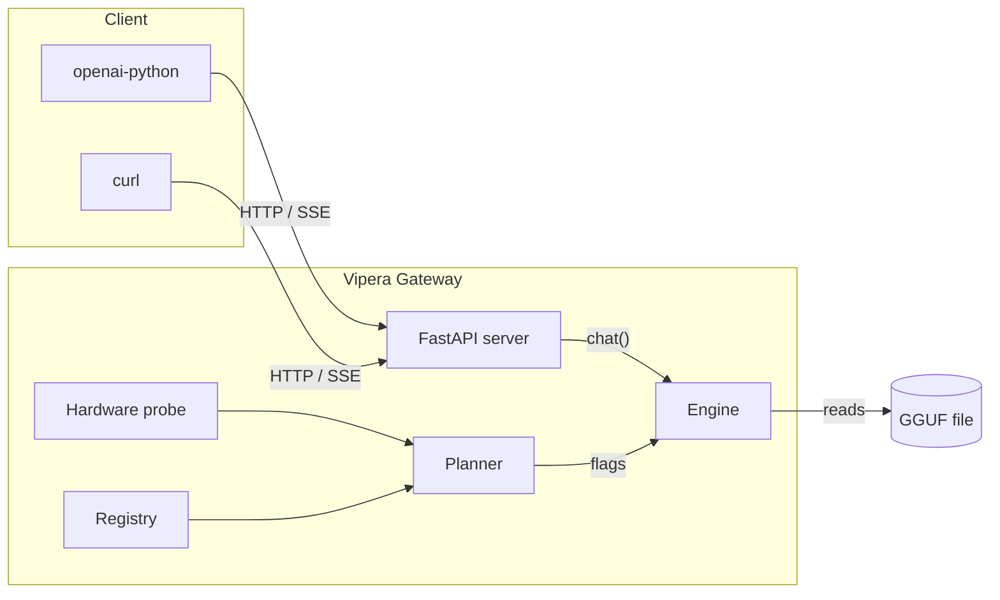

<div align="center">


# Vipera

**A local AI gateway that plans before it runs.**

One `.gguf` in, an OpenAI-compatible HTTP server out — on hardware where the
model does not quite fit.

[](https://github.com/vipera-iso/vipera/actions/workflows/ci.yml)
[](https://github.com/vipera-iso/vipera/actions/workflows/docs.yml)
[](pyproject.toml)
[](LICENSE)
[](CHANGELOG.md)

</div>

## The problem it solves

A 14B model on a 4 GB card looks like a CPU-only model. It is not: 17 of its 40
layers fit in VRAM at 8K context, and putting them there is the difference
between 6.6 and 0.2 tokens/second.

Vipera measures the machine, budgets VRAM and RAM **per layer**, and hands
`llama.cpp` a plan it can justify:

```bash
vipera system doctor        # what the machine actually has
vipera serve start          # plan, load, serve
curl localhost:8686/health  # {"status": "ok", "model": "..."}
```

Measured on a GTX 1650 4 GB, Hermes-4-14B Q3_K_M at 8K context:

| | layers on GPU | VRAM used | decode |
|---|---:|---:|---:|
| CPU only | 0/40 | — | 0.2 t/s |
| Vipera's plan | 17/40 | 3.37 GB | 6.57 t/s |

The whole plan is printed before the model loads, and every flag in it is
traceable to a measurement: [`planner.py`](src/vipera/planner.py) carries the
numbers in comments, [`docs/benchmarks.md`](docs/benchmarks.md) carries the runs.

## Install and run

> [!NOTE]
> The distribution is `vipera-ai`. The PyPI project named `vipera` is an
> unrelated PDF tool. Step-by-step help: [installation guide](docs/install.md).

```bash
pip install "vipera-ai[llama,gguf,nvidia]"   # llama-cpp-python builds for your platform
vipera model search                          # fetch a GGUF from Hugging Face
vipera serve start                           # → http://127.0.0.1:8686/v1
```

```python
from openai import OpenAI

client = OpenAI(base_url="http://127.0.0.1:8686/v1", api_key="none")
stream = client.chat.completions.create(
    model="qwen2.5-7b-instruct",  # the alias from GET /v1/models; omit to use the loaded model
    messages=[{"role": "user", "content": "Explain MoE in one paragraph."}],
    stream=True,
)
for chunk in stream:
    print(chunk.choices[0].delta.content or "", end="")
```

Verified clients: `openai-python`, LangChain, LlamaIndex, Continue, the OpenAI
Playground.

## Should you use it?

| You want | Use |
|---|---|
| A model that spills VRAM or RAM, placed layer by layer instead of failing at load | **Vipera** |
| An OpenAI-compatible endpoint from a `.gguf` with no separate inference stack | **Vipera** |
| A reviewable answer to "why were these flags chosen" | **Vipera** ([planner](src/vipera/planner.py), [plan docs](docs/architecture.md#planner)) |
| Peak tokens/second on hardware you already tuned | `llama.cpp/server` directly |
| A desktop app with a model browser and chat UI | LM Studio |
| Multi-model routing, auth, TLS, or a web dashboard | Not this — one model per process, loopback by default |

Feature-by-feature with sources: [docs/comparison.md](docs/comparison.md).

## How it decides



| Module | Job |
|---|---|
| [`hardware.py`](src/vipera/hardware.py) | Cores, RAM, GPU, VRAM. No side effects. |
| [`planner.py`](src/vipera/planner.py) | `(model meta, hardware) → Plan`: layers, KV dtype, batch, `mlock`, KQV offload. |
| [`engine.py`](src/vipera/engine.py) | Drives `llama.cpp`; owns the GPU → CPU ladder and the bake-off between backends. |
| [`server.py`](src/vipera/server.py) | FastAPI with real SSE, flushed per token. |
| [`registry.py`](src/vipera/registry.py), [`ui.py`](src/vipera/ui.py) | Model store and the Rich terminal UI. |

Concurrency model, fallback ladder, and known gaps:
[docs/architecture.md](docs/architecture.md). The terminal's visual rules:
[docs/design/visual-system.md](docs/design/visual-system.md).

## CLI

| Command | What it does |
|---|---|
| `vipera` | Start the gateway with the default model. |
| `vipera serve start` | Serve a model over the OpenAI API. |
| `vipera model search` | Search Hugging Face and download a GGUF. |
| `vipera model add ollama:qwen2.5:7b` | Import a model Ollama already pulled, without copying it. |
| `vipera chat repl` | Chat against a local model in the terminal. |
| `vipera bench run` | Measure prompt and generation throughput. |
| `vipera system doctor` | Runtime, library, and hardware check. |

Every command, flag, and default: [docs/cli.md](docs/cli.md).

## HTTP API

| Method | Path | Returns |
|---|---|---|
| `GET` | `/health` | `{"status": "ok", "model": "<alias>"}` |
| `GET` | `/v1/models` | OpenAI-shaped model list |
| `POST` | `/v1/chat/completions` | Chat completion, streaming or not |
| `POST` | `/v1/embeddings` | Embeddings, with `embeddings: true` in the config |
| `POST` | `/api/chat` | Same chat through the Ollama layer (`--protocol openai,ollama`) |

```bash
curl http://127.0.0.1:8686/v1/chat/completions \
  -H "Content-Type: application/json" \
  -d '{"messages": [{"role": "user", "content": "Hello"}]}'
```

Schemas, SSE framing, and Python/JavaScript examples:
[docs/http-api.md](docs/http-api.md).

## Configuration

Config lives at `~/.vipera/config.json`. Change it with `vipera system config`
or edit the JSON. The keys that change behavior most: `profile` (`auto`, `cpu`,
`gpu`, `lowmem`, honored by serve, chat, and bench), `ctx`, `kv_cache` (`f16`,
`q8_0`, `q4_0`), `spec_type` (draft-free n-gram speculation, off by default:
+37% when the answer rewrites the prompt, −2% on fresh prose), `parallel`
(llama-server slots; four of them measured +29% aggregate throughput on
concurrent requests), `default_model`. Invalid values are repaired on load;
`vipera system config` refuses to write them.

The optimization layer (`shaping`, `tuning`, both on) trims a request that is
larger than the loaded context instead of letting llama.cpp cut the system
prompt, and reuses the layer split a previous `vipera bench` measured on this
machine. `/health` reports prefix-cache reuse. Details:
[docs/architecture.md](docs/architecture.md#optimization-layer).

Full table: [docs/configuration.md](docs/configuration.md).

## What the numbers look like

Two findings from [docs/benchmarks.md](docs/benchmarks.md), both on consumer
hardware:

- **Quantize with an importance matrix, not blindly.** Q3_K_M + imatrix is
  18.7% smaller than Q4_K_M (7.32 vs 9.00 GB), loads 25% faster, prefills 27%
  faster, and lands within the eval-set error on perplexity (6.9805 vs 7.0056,
  a 0.11σ gap). Say "same quality, 19% lighter", not "better".
- **`kv_cache: q8_0`** halves KV memory for about 3% decode throughput. `q5_1`
  and `iq4_nl` cost 14–18%: use them only when KV size blocks the context you
  need.

## Contributing

```bash
git clone https://github.com/vipera-iso/vipera
cd vipera
python -m venv .venv && .venv/bin/pip install -e ".[dev,llama,gguf]"
.venv/bin/pre-commit install
.venv/bin/pytest -q
```

[CONTRIBUTING.md](CONTRIBUTING.md) (dev setup, PR flow, demo GIF) ·
[SECURITY.md](SECURITY.md) (vulnerability reporting) ·
[CHANGELOG.md](CHANGELOG.md) (release history) ·
[Code of conduct](CODE_OF_CONDUCT.md)

MIT © 2026 Vipera — see [LICENSE](LICENSE).
