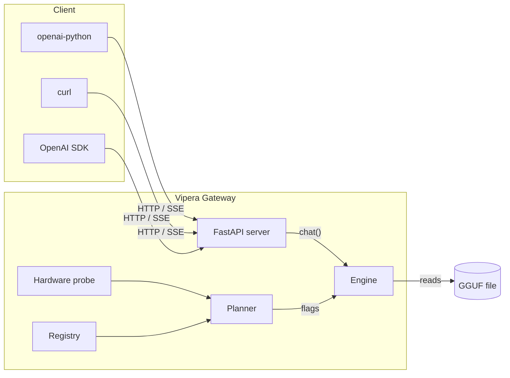

<div align="center">

# Vipera

**Modern local AI gateway — OpenAI-compatible, GGUF-native, one command.**

[](https://github.com/vipera-iso/vipera/actions/workflows/ci.yml)
[](https://python.org)
[](LICENSE)
[]()
[](CONTRIBUTING.md)

[Quick start](#-quick-start) · [CLI](#-cli-reference) · [HTTP API](#-http-api) · [Docs](#-documentation) · [Contributing](CONTRIBUTING.md)

</div>

---


## What is Vipera?

Vipera turns a `.gguf` file into a **production-shaped, OpenAI-compatible HTTP
endpoint** — in a single command. It reads the hardware it's running on, plans
which layers belong in VRAM, RAM, or disk, and then drives `llama.cpp` with the
exact flags that plan implies. No reimplemented runtime, no second inference
engine, no guessing.

```bash
pip install "vipera-ai[llama,gguf,nvidia] @ git+https://github.com/vipera-iso/vipera.git"
vipera model search         # download a GGUF from HuggingFace
vipera serve start          # → http://127.0.0.1:8686/v1/chat/completions
```

> The distribution is named `vipera-ai`; it is not on PyPI yet. The PyPI project
> named `vipera` is an unrelated tool, so do not install that. Use the GitHub
> source command above, or follow the no-Git
> [installation guide](docs/install.md).


That endpoint speaks the OpenAI Chat Completions protocol with real SSE
streaming, so every existing client — `openai-python`, LangChain, LlamaIndex,
Continue, the OpenAI Playground — works without code changes.

## Why Vipera?

Most local LLM tools make you choose between a friendly CLI and a real server.
Vipera is both, with a planner in the middle that most tools skip.

| | **Vipera** | Ollama | `llama.cpp/server` | LM Studio |
|---|:---:|:---:|:---:|:---:|
| GGUF-native | ✅ | ✅ | ✅ | ✅ |
| OpenAI-compatible API | ✅ | ✅ | ✅ | ✅ |
| **Hardware-aware planner** (VRAM/RAM/disk) | ✅ | ⚠️ partial | ❌ | ⚠️ |
| Real SSE streaming | ✅ | ✅ | ✅ | ✅ |
| First-class CLI (no GUI) | ✅ | ✅ | ✅ | ❌ |
| HuggingFace search built-in | ✅ | ✅ | ❌ | ✅ |
| Diagnostics (`doctor`) | ✅ | ⚠️ | ❌ | ❌ |
| Python-native, embeddable | ✅ | ❌ | ❌ | ❌ |

Where Vipera differs in practice:

- **It plans before it runs.** `vipera system doctor` tells you whether your
  machine can run the model *before* you wait five minutes for a failed load.
  The planner emits `-ngl`, `--n-cpu-moe`, KV quant types, `mlock` and
  `n_batch` from a hardware profile — not a hardcoded default.
- **It falls back honestly.** If GPU offload fails at load time, the engine
  retries with a CPU-safe plan and tells you what changed. It does not crash,
  and it does not silently degrade.
- **The CLI and the API are the same stack.** `vipera chat` and
  `/v1/chat/completions` share one engine instance per model — so benchmarks
  you run in the terminal describe the server you actually serve.

## ⚡ Quick start

```bash
# 1. install (see docs/install.md for a no-Git option)
pip install "vipera-ai[llama,gguf,nvidia] @ git+https://github.com/vipera-iso/vipera.git"

# 2. fetch a model
vipera model search

# 3. serve it
vipera serve start
```

That's it. Then point any OpenAI client at `http://127.0.0.1:8686/v1`:

```python
from openai import OpenAI

client = OpenAI(base_url="http://127.0.0.1:8686/v1", api_key="none")

stream = client.chat.completions.create(
    model="default",
    messages=[{"role": "user", "content": "Explain MoE in one paragraph."}],
    stream=True,
)
for chunk in stream:
    print(chunk.choices[0].delta.content or "", end="")
```

## 🧭 CLI reference

Vipera ships a single `vipera` entry point. Every command is discoverable with
`vipera <command> --help`.

### Top-level

| Command | Description |
|---|---|
| `vipera` | Start the gateway with the default model. |
| `vipera -s` / `--select` | Start the gateway with an interactive model picker. |
| `vipera --version` | Print the version. |
| `vipera help` | Print the full command reference. |

### `vipera model` — manage GGUF artifacts

| Command | Description |
|---|---|
| `vipera model search` | Search HuggingFace for GGUF models, then download one. |
| `vipera model import <path> [--name <alias>]` | Copy a local `.gguf` into the Vipera store. |
| `vipera model inspect <path> [--tensors]` | Analyze GGUF metadata, tensor categories, and quantization mix. |
| `vipera model list` | List every model registered locally. |
| `vipera model rm <alias> [--yes]` | Remove a model and its file. |

### `vipera serve` — HTTP gateway

| Command | Description |
|---|---|
| `vipera serve start [--model] [--host] [--port] [--profile] [--ctx]` | Load a model and start the OpenAI-compatible server. |
| `vipera serve status` | Probe the configured host/port for a live gateway. |

### `vipera chat` — terminal chat

| Command | Description |
|---|---|
| `vipera chat repl [-m <alias>]` | Interactive multi-turn REPL. |
| `vipera chat oneshot "<prompt>" [-m <alias>]` | One turn, print, exit. |

### `vipera bench` — performance

| Command | Description |
|---|---|
| `vipera bench run [model] [--ctx 512,2048] [--max-tokens N]` | Measure prompt and generation throughput across context sizes. |

### `vipera system` — diagnostics & config

| Command | Description |
|---|---|
| `vipera system doctor` | Runtime, library, and hardware check. |
| `vipera system config [key] [value]` | View or set configuration keys. |

## 🔌 HTTP API

### Endpoints

| Method | Path | Description |
|---|---|---|
| `GET`  | `/health` | `{"status": "ok", "model": "<alias>"}` |
| `GET`  | `/v1/models` | OpenAI-shaped model list. |
| `POST` | `/v1/chat/completions` | Chat completion, streaming or non-streaming. |

### curl — non-streaming

```bash
curl http://127.0.0.1:8686/v1/chat/completions \
  -H "Content-Type: application/json" \
  -d '{
    "model": "default",
    "messages": [{"role": "user", "content": "Hello!"}]
  }'
```

### curl — streaming

```bash
curl -N http://127.0.0.1:8686/v1/chat/completions \
  -H "Content-Type: application/json" \
  -d '{
    "model": "default",
    "messages": [{"role": "user", "content": "Count to 5."}],
    "stream": true
  }'
```

### JavaScript

```js
import OpenAI from "openai";

const client = new OpenAI({
  baseURL: "http://127.0.0.1:8686/v1",
  apiKey: "none",
});

const stream = await client.chat.completions.create({
  model: "default",
  messages: [{ role: "user", content: "hi" }],
  stream: true,
});

for await (const chunk of stream) {
  process.stdout.write(chunk.choices[0]?.delta?.content ?? "");
}
```

### Compatibility

Vipera implements the **OpenAI Chat Completions** schema and SSE framing. The
`model` field in the request is accepted for client compatibility but ignored:
one gateway serves one model.

## 🧱 Architecture



**Layers:**

- `vipera/hardware.py` — probes CPU cores, RAM, GPU name, VRAM. No side effects.
- `vipera/planner.py` — turns `(model meta, hardware)` into a concrete `Plan`
  (`gpu_layers`, `context`, `kv_cache`, `flash_attn`, `n_batch`, `use_mlock`,
  `offload_kqv`).
- `vipera/engine.py` — wraps `llama_cpp.Llama` from a `Plan`; handles the
  GPU → CPU fallback path and the `mlock` retry.
- `vipera/server.py` — FastAPI app; real SSE for streaming, threadpool for
  blocking inference. Sync generator returned directly to `StreamingResponse`,
  so chunks flush per token.
- `vipera/registry.py` — JSON model store at `~/.vipera/registry.json`.
- `vipera/ui.py` — Rich-based CLI (banner, panels, picker, typewriter stream).
- `vipera/commands/*` — one file per CLI subcommand.

## ⚙️ Configuration

Config lives at `~/.vipera/config.json`. Set it via `vipera system config`, or
edit the JSON — unknown keys are rejected, known keys are type-coerced.

| Key | Type | Default | Meaning |
|---|---|---|---|
| `host` | `str` | `127.0.0.1` | Gateway bind address. |
| `port` | `int` | `8686` | Gateway port. |
| `default_model` | `str \| null` | `null` | Alias used when `--model` is not given. |
| `profile` | `str` | `auto` | Planner profile (`auto`, `speed`, `balanced`). |
| `ctx` | `int` | `8192` | Context size in tokens. |
| `kv_cache` | `str` | `q8_0` | KV cache type (`f16`, `q8_0`, `q4_0`, ...). |
| `flash_attn` | `bool` | `true` | Enable flash attention when GPU present. |
| `n_batch` | `int` | `512` | Prompt batch size. |
| `temperature` | `float` | `0.7` | Sampling temperature. |
| `max_tokens` | `int` | `2048` | Generation cap. |
| `top_p` | `float` | `0.95` | Nucleus sampling. |
| `show_bench_on_start` | `bool` | `true` | Run a quick speed check after `serve start` loads. |

**Storage layout:**

```
~/.vipera/
├── config.json      # gateway config
├── registry.json    # model index
├── models/          # *.gguf artifacts
└── logs/            # reserved
```

Override the home with `VIPERA_HOME=/path/to/dir`.

## 🔬 GGUF inspection

`vipera model inspect` reads the GGUF index only — weights are never loaded
into memory — and prints the architecture, layer/context/embedding sizes, a
size breakdown by tensor category (embedding, attention, FFN, expert, norm),
and the quantization mix.

```bash
vipera model inspect ~/.vipera/models/model.gguf
vipera model inspect ~/.vipera/models/model.gguf --tensors   # every tensor
```

It warns when quality-sensitive tensors (`attn_v`, `ffn_down`, including their
`_exps` variants) are quantized below Q4_K. That check is a heuristic, not a
quality measurement. The command is read-only; imatrix and quantize pipelines
are not implemented yet.

## 📊 Benchmarks

Vipera measures what the gateway actually produces, on the machine it runs on.
Numbers below are from the reference box; re-run with `vipera bench run` on
yours — that is the point.

**Reference machine**

| | |
|---|---|
| CPU | Intel i5-11300H — 4C / 8T |
| RAM | 15 GiB, ~10 GiB free, no swap |
| GPU | NVIDIA GTX 1650 Max-Q, 4 GB VRAM |
| Model | DeepSeek-V2-Lite Q4_K_M (9.65 GB, MoE 15.7B / 2.4B active) |
| Runtime | llama.cpp CPU build, `-ngl 0` |

| Config | Gen t/s | Prompt t/s | Peak RSS |
|---|---:|---:|---:|
| CPU only, mmap | 16.0 | 44 | 12.6 GiB |
| CPU only, `-lm mlock` | 22.9 | — | ~10 GiB |
| CUDA offload (experts on CPU) | 6.8 | — | — |
| Vulkan offload | 3.4 | — | — |

**Read this as:** on a model that already fits in RAM, this class of gateway
does not beat `llama.cpp` defaults — the load-flag layer (`mlock`, `n_batch`)
moves throughput 1.4× while placement does not, because there is nothing to
place. Vipera earns its keep at the edges: when the model *spills* RAM, when
the machine has multiple accelerators of different capabilities, or when the
operator does not know which of forty flags to pass. `vipera bench run` is the
instrument; the numbers are yours.

## 📚 Documentation

Start at the [docs index](docs/README.md).

- [Installation](docs/install.md) — step-by-step setup for non-technical users.
- [Architecture](docs/architecture.md) — module map, planner, engine fallback, concurrency.
- [CLI reference](docs/cli.md) — every command, flag, and default.
- [HTTP API](docs/http-api.md) — endpoints, schemas, SSE framing, client examples.
- [Configuration](docs/configuration.md) — config keys, storage layout, registry schema.
- [Development](docs/development.md) — setup, tests, CI, release process.
- [CONTRIBUTING.md](CONTRIBUTING.md) — dev setup, PR flow, how to record the demo GIF.
- [SECURITY.md](SECURITY.md) — reporting vulnerabilities, supported versions.
- [CODE_OF_CONDUCT.md](CODE_OF_CONDUCT.md) — Contributor Covenant 2.1.
- [CHANGELOG.md](CHANGELOG.md) — release history.

## 🤝 Contributing

Issues and PRs are welcome. First-timers: look for
[`good first issue`](https://github.com/vipera-iso/vipera/labels/good%20first%20issue).

```bash
git clone https://github.com/vipera-iso/vipera
cd vipera
python -m venv .venv && .venv/bin/pip install -e ".[dev,llama,gguf]"
.venv/bin/pre-commit install
.venv/bin/pytest -q
```

See [CONTRIBUTING.md](CONTRIBUTING.md) for the full guide.

## 📄 License

MIT © 2026 Vipera — see [LICENSE](LICENSE).
