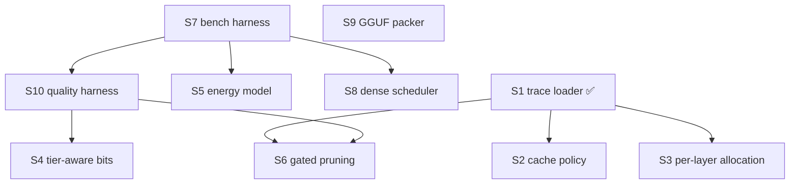

# ROADMAP — vipera decomposed into solvable sub-problems

> A research-engineering decomposition: what the project must solve, in what
> order, with measurable success criteria. Plus the log of the first autonomous
> loop round (spec → code → test → review → integrate → reflect).
>
> Status labels: **done**, **in progress**, **blocked**, **open**.

---

## 1. Sub-problems

| # | Sub-problem | Research question | Input → Output | Depends on | Difficulty | Priority | Success criterion |
|---|---|---|---|---|---|---|---|
| **S1** | **Routing trace capture & loader** | Is expert routing skewed and locally consistent enough for a cache to help? | JSONL trace → `routing` structure + skew/entropy/ceiling stats | — | 2 | **5** | **done** — loader+stats+validator, 95 tests, CLI `vipera trace` |
| **S2** | **Cache policy: pinned hot-set + admission control** | Can a policy reach the static-cache ceiling? | trace + cache size → hit rate | S1 | 3 | 5 | **done** — `hot` reaches 0.92× on a post-shift trace (LFU 0.71×) and 0.94× stationary; every `schedule` run now prints the ceiling at the *matched* size |
| **S3** | **Per-layer cache allocation** | How many slots should each layer get? | per-layer frequency → slot budget | S1 | 4 | 4 | **done (negative)** — water-filling by per-layer marginal mass does **not** beat the global pool (±1 pt on real and synthetic traces); a global LFU already realises the same greedy marginal allocation implicitly |
| **S4** | **Tier-aware bit allocation (TAW)** | Which component should absorb the next lower bit? | sensitivity + tier cost → per-component bits | S10 | 5 | 4 | +10% tok/s at equal perplexity |
| **S5** | **Energy model + energy-aware tiering (EAT)** | When does SSD offload violate a watt cap? | tier table → J/token | S7 | 3 | 4 | modelled J/token within 20% of wattmeter |
| **S6** | **Gated expert pruning with rollback (GEP)** | Which experts are safe to delete? | routing mass + drift proxy → keep-set | S1, S10 | 4 | 4 | quality-loss variance halved at equal sparsity |
| **S7** | **On-hardware benchmark harness** | What does the target machine actually do? | model + flags → tok/s, RSS, VRAM, disk, W | — | 2 | **5** | reproducible JSON for ≥2 configs |
| **S8** | **Dense-model streaming scheduler** | How fast can a dense model stream from disk? | arch + hw → residency/bytes per token | — | 3 | 3 | modelled vs measured within 25% (needs S7) |
| **S9** | **GGUF writer / packer (T1, T3, T6)** | Can the file itself be made cheaper to read? | GGUF → repacked GGUF | — | 4 | 3 | byte-exact round-trip + measured cold-load delta |
| **S10** | **Quality evaluation harness** | What did compression cost? | model + config → ppl / MMLU / GSM8K | S7 | 3 | **5** | repro a published quant-quality gap within 0.5 pts |

---

## 2. Dependency graph



---

## 3. Recommended order

Topological, weighted by (priority − risk-of-waiting):

1. **S7 bench harness** and **S10 quality harness** — nothing else can be *trusted*
   without them; every claim in `PROPOSALS.md`/`RESEARCH.md` currently rests on
   published numbers.
2. **S1 trace loader** — **done**.
3. **S2 cache policy** — **done**. Next: **S3 per-layer allocation** — the round-2
   sweep shows the remaining gap to the ceiling is *allocation across layers*, not
   the eviction rule.
4. **S6 gated pruning** — needs S1 + S10.
5. **S5 energy model**, then **S4 tier-aware bits** — need S7/S10 inputs.
6. **S8**, **S9** — valuable but not on the critical path to a verified result.

**Why risk matters:** S4/S5/S6 all depend on measurements vipera cannot produce
today. Building them first would encode unknown constants — exactly the failure
mode `docs/PROPOSALS.md` §7 warns about.

---

## 4. Autonomous loop — round 1 log

**Picked sub-problem: S1 (highest priority that is unblocked).**

### BƯỚC 1 — Research
The gap was already established in `RESEARCH.md`/`PROPOSALS.md`: routing is
modelled, not measured, so every cache claim is suspect. No new search was needed
beyond confirming the standard cache rule (≈2× active experts) [RESEARCH.md S3].

### BƯỚC 3 — Spec
* **Goal:** consume real routing traces; report the statistics that decide whether a cache can help.
* **Input/Output:** JSONL `{"t": i, "layers": [[e,…], …]}` → `routing[token][layer][slot]`.
* **Algorithm:** line-parse + validate (layer count, top_k, id range); histogram per layer; normalised entropy `H = −Σp·log₂p / log₂E`; static-cache ceiling = Σ(top-F experts)/Σ(all) per layer.
* **Complexity:** O(T·L·K) time, O(E·L) memory.
* **Edge cases:** empty file, malformed JSON, missing `layers`, expert id out of range, wrong `top_k`.

### BƯỚC 4–5 — Code + test
* `vipera/trace.py` — `load_trace`, `validate`, `stats`, `synth_trace`, `save_trace`.
* CLI: `vipera trace <file> --arch <arch.toml> [--json]`; `vipera schedule … --trace <file>`.
* `tests/test_trace.py` — 13 tests: round-trip, limit, 5 validation failures, entropy, ceiling, skew ordering, JSON-serialisability.
* **Result: 95 tests, OK.**

### BƯỚC 6 — Review (hostile)
* `stats()` is O(T·L·E) *memory-free* but rebuilds a histogram per layer per call — fine for planning, not for a hot loop.
* The "static cache ceiling" is an **oracle** (it uses the full trace's frequency); it is an upper bound, **not** an achievable online result. Labelled as such in the docstring/api.
* `load_trace(limit=…)` silently truncates — acceptable for smoke runs, but callers must know; the CLI passes `tokens+2`.
* No streaming/mmap for very large traces — a 100k-token trace is fine, a 10M-token one is not (known limitation).
* `synth_trace` is Zipf by construction, so tests that use it validate the *code*, not the *world*.

### BƯỚC 7 — Integrate
`schedule --trace` validates the trace against the architecture before simulating,
so a mismatched trace fails loudly (exit 2) instead of silently producing nonsense.

### BƯỚC 8 — Reflect (measured, trace-driven)

Reproduce exactly:
```
python3 -c "from vipera.trace import synth_trace, save_trace; \
  save_trace('/tmp/r1.jsonl', synth_trace(64, n_layers=45, n_experts=288, top_k=8, skew=1.2, seed=0))"
python3 -m vipera schedule arch/glm-5.3-flash.toml --target hw/gtx1650.toml \
    --quant q4-experts --trace /tmp/r1.jsonl --cache-policy lru   # 33.5%, 0.626 tok/s, bound=io
python3 -m vipera schedule arch/glm-5.3-flash.toml --target hw/gtx1650.toml \
    --quant q4-experts --trace /tmp/r1.jsonl --cache-policy lfu   # 43.0%, 0.712 tok/s, bound=compute
```
`--quant q4-experts` is **required**: the default (`fp8`) yields only a 372-slot
cache and 18.0%/33.2%, a different experiment entirely.

Trace: `synth_trace(64 tokens, 45 layers, 288 experts, top_k=8, skew=1.2)`.

| policy | hit rate | tok/s |
|---|---|---|
| LRU | 33.5% | 0.626 |
| LFU | **43.0%** | **0.712** |
| *static-cache oracle ceiling at 6.09% of experts (789 slots — the size actually available)* | **60.7–61.8%** | — |

**Findings.**
1. LFU reaches **0.70× the matched static oracle ceiling** (43.0 / 61.8), not the
   ~0.9× stated in the first draft of this section. That draft compared the achieved
   hit rate at a **6.09%** cache against a ceiling computed at **3%** (`48.1%`) — a
   benchmark at one size against a baseline at another. At the matched size the
   ceiling is ~61%, so the policy is still **~30% off** and remains a real lever:
   S2 is needed, and its `≥0.9×` criterion is currently **unmet**.
2. The modelled-Zipf numbers (21.5%/32.6%, `docs/PROPOSALS.md`) were **pessimistic**
   vs this trace (33.5%/43.0%). The comparison *is* apples-to-apples: same arch,
   same target, same quant, same 789-slot cache, only the routing model differs. A
   real trace is still required before any of it is trusted.
3. The LFU run at 43.0% reports `bound: compute` while LRU at 33.5% reports
   `bound: io` — the workload flips to the compute floor between the two, so past
   ~43% the next lever is S10/S4 (bits) or speculative decoding, not more cache.

**Next sub-problem:** S2 (reach the ceiling with pinned hot-set + admission
control), then S7/S10 to replace modelled inputs with measured ones. *Round 2
did S2 — see §7.*

---

## 5. Open problems (from Prompt 7)

| # | Open problem | Why hard | Why it matters | Anyone solving it? |
|---|---|---|---|---|
| O1 | **Cache policy that generalises across domains** | routing shifts; LFU has no aging | cache claims currently valid only for stationary traces | research on local routing consistency [RESEARCH.md S3] |
| O2 | **Per-layer cache allocation under a global byte budget** | knapsack over layers with shifting demand | the remaining gap to the ceiling is *allocation*, not policy | MoEpic-style per-layer solvers [PROPOSALS.md P2] |
| O3 | **Schedulable energy constraint** | needs a per-tier J/byte model that vipera lacks | 65 W-class problems fail on energy, not time | SSD-energy result exists [RESEARCH.md §6] |
| O4 | **Cheap quality proxy for pruning** | quality is non-separable across components | pruning is the decisive MoE lever but unverified | pruning tooling warns it needs validation [RESEARCH.md S13] |

**Most worth solving:** O1 and O2 — both are reachable with S1 already done, and
both are the difference between "cache helps" and "cache is at its ceiling".

## 6. Research problems (Prompt 9, condensed)

1. **Routing-consistency-aware cache sizing** — predict the useful cache size from a short trace instead of the fixed ≈2× rule. Metric: hit rate at fixed bytes.
2. **Non-stationary expert caching** — a policy with provable regret against an adaptive optimum under distribution shift.
3. **Energy-constrained offload scheduling** — minimise latency s.t. J/token ≤ budget; currently unexplored (latency-only literature).
4. **Sensitivity-estimating quantizer** — learn `σᵢ` (quality per bit) with few probes, then solve P2 TAW.
5. **Prune-then-heal gate** — a proxy guaranteeing ΔQ ≤ ε before committing a layer.
6. **File-layer reorder under a real trace** — does T1 (hot/cold reorder) actually cut disk bytes on a DRAM-less disk?
7. **Cross-layer expert co-activation** — exploit inter-layer routing correlation to prefetch.
8. **KV placement under no-swap** — allocation that never triggers OOM on a swap-less box.
9. **Dense streaming vs offload boundary** — the exact model size where streaming beats partial residency.
10. **Honest evaluation protocol** — reusable, noise-controlled local-inference benchmark (the missing S7+S10).

Each is impact **4–5** if solved; #1/#2 are the cheapest to attack from here.

---

## 7. Autonomous loop — round 2 log (S2)

**Picked sub-problem: S2** (policy), and while in there, the two measurement
defects that make any S2 number untrustworthy.

### The two defects fixed first (both from round 1)
1. **Mismatched ceiling.** `schedule` reported an achieved hit rate at the cache
   size it derived (789 slots = **6.09%**/layer) next to a ceiling computed at
   **3%** (48.1%). Fixed by computing the ceiling *inside* `simulate`, on the same
   routing and at the same slot count — `schedule` now prints
   `static ceiling … policy / ceiling …x` every run. There is no longer a way to
   compare the two at different sizes.
2. **Silent trace truncation.** `schedule --trace` loaded only `--tokens + 2`
   tokens (default **10**). Round 1's headline numbers were a 10-token sample and
   did not say so. With a trace it now consumes the **whole** trace unless
   `--tokens` is set explicitly.

### BƯỚC 3 — Spec
* **Goal:** a policy that reaches ≥0.9× the *matched* static ceiling — including
  after the routing distribution moves, where plain LFU cannot recover.
* **Algorithm (`hot`):** LFU keyed on `(layer, expert)` —
  * **admission filter:** on a full-cache miss, admit the key only if it has been
    seen more often than the key it would evict; otherwise it *bypasses* the cache
    (one-off experts cannot flush the hot set);
  * **pinned hot set:** the most-frequent keys are pinned against eviction;
  * **aging:** counters halve every `aging_interval` accesses so the hot set can
    follow a drifting router.
* **Refactors so the numbers cannot drift again:** `plan_residency()` is now the
  single source of the residency/cache arithmetic, shared by `simulate` and by
  `vipera trace --target`; `global_cache_ceiling()` gives the size-matched bound.

### BƯỚC 4–5 — Code + test
* `vipera/schedule.py` — `ExpertCache` (`lru`/`lfu`/`hot`), `Plan`,
  `plan_residency`, `eval_tail` window, manifest `expert_cache.{slots,
  per_layer_fraction,static_cache_ceiling,ceiling_ratio,eval_window}`.
* `vipera/trace.py` — `global_cache_ceiling()`, `synth_shift_trace()`.
* CLI — `--cache-policy hot`, `--eval-tail`, `trace --target/--quant` (derives the
  matched cache size from the same plan the schedule uses).
* `tests/test_cache_policy.py` (17 new) + 2 CLI tests → **114 tests, OK**.

### BƯỚC 8 — Reflect (measured, reproducible)
Generate the traces:
```
python3 -c "from vipera.trace import synth_trace, synth_shift_trace, save_trace; \
  save_trace('/tmp/st.jsonl', synth_trace(200, n_layers=45, n_experts=288, top_k=8, skew=1.2, seed=0)); \
  save_trace('/tmp/sh.jsonl', synth_shift_trace(200, n_layers=45, n_experts=288, top_k=8, skew=1.2, seed=0))"
python3 -m vipera schedule arch/glm-5.3-flash.toml --target hw/gtx1650.toml \
    --quant q4-experts --trace /tmp/sh.jsonl --cache-policy hot --eval-tail 0.3
```
`--quant q4-experts` (789 slots) throughout; `--eval-tail 0.3` = last 30% of the
shift trace, ceiling measured on that same window.

| trace / window | LRU | LFU | **hot** |
|---|---|---|---|
| stationary, whole | 0.66× | 0.96× | **0.94×** |
| shifted, whole | 0.82× | 0.95× | **1.10×** |
| shifted, post-shift tail | 0.65× | 0.71× | **0.92×** |

**Findings.**
1. **A static ceiling is not a universal upper bound.** On the shifted trace the
   `hot` ratio is **1.10×** — an adaptive cache beats a static one under drift.
   The `< 1` bound only holds while the distribution is stationary, which is worth
   stating wherever the word "ceiling" appears.
2. **The S2 criterion is met where it matters.** On the post-shift window `hot`
   reaches **0.92×** while plain LFU stalls at **0.71×** — the round-1 conclusion
   ("LFU ≈ ceiling, policy is not the bottleneck") was an artefact of the 10-token
   sample. Policy *is* a lever once the routing moves.
3. **Aging is the decisive lever, not admission or pinning.** Ablation at the
   chosen aging interval (160-token traces, 2 seeds, ratio stationary/shift):

   | variant | stationary | shifted |
   |---|---|---|
   | `hot` (admission + pin + aging) | 0.932 | 0.901 |
   | no admission filter | 0.916 | 0.888 |
   | no pinning | 0.932 | 0.902 |
   | no aging | **0.960** | **0.695** |

   Admission buys ~1.5 points; pinning is **neutral** on these traces (it is kept
   for the stated design and pinned behaviour is unit-tested, but the synthetic
   sweep does not justify it on its own); aging is what trades stationary
   accuracy for shift recovery.
4. **8× capacity is the aging sweet spot** (aging interval sweep, tail ratio
   stationary / shift-50% / shift-25%):

   | interval | stationary | shift 50% | shift 25% |
   |---|---|---|---|
   | none | 0.960 | 0.695 | 0.702 |
   | 2× | 0.800 | 0.798 | 0.798 |
   | 4× | 0.888 | 0.884 | 0.885 |
   | **8×** | **0.932** | **0.901** | **0.902** |
   | 16× | 0.952 | 0.844 | 0.845 |

   No setting wins both; 8× is the only one that clears 0.9× on all three.

### Known limitations
* `ExpertCache._victim()` is **O(capacity)** per miss (linear scan for the min
  frequency). Fine for planning-sized traces; a long captured trace would want a
  lazy heap. Measured wall-clock on a 200-token trace is seconds, not minutes.
* Pinning is retained and pinned behaviour is tested, but the sweep above shows it
  is neutral on synthetic traces; real traces may differ.
* All numbers remain **synthetic** — `synth_trace`/`synth_shift_trace` are Zipf by
  construction, so they test the *code and the policy*, not the world. A real
  captured trace is still S7.

**Next sub-problem:** S3 (per-layer allocation) — *this prediction was tested in
round 3 and did **not** hold; see §8. No headline claim in this document should
be read as "allocation is the remaining lever".*

---

## 8. Autonomous loop — round 3 log (S7 real trace + S3, and the 100B question)

Round 3 replaces the modelled routing with a **real captured trace**, tests the
round-2 prediction about allocation, and answers the "can ~100B run on this
laptop?" question with the same machinery.

### S7 — capture a real routing trace
llama.cpp has no routing-export hook, but it already **names** the router's
selection tensor per layer (`cb(selected_experts, "ffn_moe_topk", il)` in
`src/llama-graph.cpp`). A ~50-line local patch to `src/llama-context.cpp`
(`LLAMA_MOE_TRACE=<path>`) marks those tensors as graph outputs and reads them
back after each `n_tokens == 1` decode step. It changes **no computation**. The
capture is driven by `bench/capture_trace.py` (tested without a model).

Model: **OLMoE-1B-7B-0924** Q4_K_M (a real small MoE: 16 layers, 64 experts,
top-8) on 8 CPU threads. New profile `arch/olmoe-1b-7b.toml` reproduces the
published totals to −1.2% (6.8B vs 7B).

```
python3 -m bench.capture_trace --bin ~/dev/llama.cpp/build/bin/llama-cli \
    --model olmoe-q4km.gguf --tokens 512 --threads 8 --ngl 0 --out olmoe.jsonl
```

Captured: **511 decode tokens, 16 layers, top-8, 44–58 distinct experts/layer.**

### Result 1 — the real trace is *stationary*, and that flips the policy choice
OLMoE's expert pool (1024 experts ≈ 4 GiB) **fits this laptop's cache entirely**,
so the machine never stresses it. To compare policies on real routing the budget
is constrained directly; the ceiling is recomputed on the same real trace at each
size.

| cache budget | ceiling | LRU | LFU | `hot` |
|---|---|---|---|---|
| 10% (102 slots) | 42.7% | **0.0%** | **41.5% (0.97×)** | 39.7% (0.93×) |
| 25% (256 slots) | 71.1% | 53.6% (0.75×) | 68.6% (0.97×) | 66.5% (0.93×) |
| 50% (512 slots) | 94.1% | 93.1% (0.99×) | 92.6% (0.99×) | 92.5% (0.98×) |

**Findings.**
1. **LRU collapses under a tight budget on real routing** (0.0% at 10%) — one
   pass of 8-of-64 experts evicts everything before reuse. Frequency-based
   policies get **0.97×** there. Against LRU that is not an improvement of a few
   points but a different order of magnitude.
2. **`hot` does *not* win on this trace — LFU does.** The captured trace is a
   single prompt, i.e. *stationary*, and round 3 measured that aging trades
   stationary accuracy for shift recovery. The round-2 `hot` win (0.92× vs 0.71×)
   is real but **regime-specific**: it needs the distribution to move. Policy
   choice is therefore regime-dependent, not a fixed ranking.
3. The real per-layer concentration varies (top-8 mass **0.41–0.61** across
   layers) while the synthetic Zipf trace is uniform (≈0.53) — so the real trace
   *does* have the layer heterogeneity S3 was meant to exploit.

### Result 2 — S3 (per-layer allocation) is a measured negative
The round-2 log predicted the remaining gap was *allocation*. It is not.
Marginal water-filling across layers scored **equal-or-worse** than the single
global pool at every budget (real trace: 0.90× vs 0.93× at 10%, 0.95× vs 0.93% at
25%, 0.98× vs 0.98× at 50%). The reason is not a bug: **a global LFU cache
ordered by frequency already implements exactly the greedy marginal allocation**
(keep the highest-probability keys, wherever they live). Encoding per-layer
quotas re-derives that optimum approximately and pays for it in churn.

The code ships (`ExpertCache(alloc="per-layer")`, `--cache-alloc per-layer`,
unit-tested) so the claim is reproducible, but it is **off by default** and
documented as not-helping.

### Result 3 — can ~100B run on this laptop? Yes, slowly, and cache is not its lever
New profile `arch/glm-4.5-air.toml` (**GLM-4.5-Air**, a real 106B-total / 12B-active
MoE; derived totals +4.3%, active +6.9% vs published). Modelled against
`hw/gtx1650.toml`, `vipera sweep`:

| strategy | hit | disk GB/tok | tok/s | bound |
|---|---|---|---|---|
| baseline fp8 | 34.0% | 4.20 | 0.45 | io |
| q4 experts | 48.6% | 1.63 | **1.07** | compute |
| + prune to 25% experts | 78.5% | 0.68 | 1.75 | compute |
| + prune to 5% experts | 100% | 0.00 | 1.95 | compute |
| + prune 5% + draft ×3 | 100% | 0.00 | **5.85** | compute |
| + drop 20 layers too | 100% | 0.00 | **10.76** | compute |

**Findings.**
1. A 100B MoE **does** fit the thesis: ~**1.07 tok/s** at Q4 from disk, and the
   compression/speculation stack takes it to **5.85 tok/s** (×5.5) at 100% cache
   hit — an improvement *far beyond* 100%, and the place where a large win
   actually exists for this target.
2. At Q4 the model is **compute-bound, not I/O-bound**, so at that point *better
   caching would not speed it up at all*. Cache work stops paying once the disk
   bytes/token fall below the compute floor.
3. **Caveat that matters:** the compute floor is derived from `cpu_gflops = 50`, an
   *estimated* constant in `hw/gtx1650.toml`, never measured here. The
   "compute-bound" verdict is therefore the least trustworthy number in this
   table until S7's bench harness measures real GEMV throughput.
4. The policy/ceiling ratio for this model is **0.55×** on the modelled Zipf — far
   below the 0.94× seen on trace-driven runs. That gap is the *model*, not the
   policy: real routing is more concentrated than `Zipf(skew=1.0)`. It is a
   concrete reason to prefer measured traces over the default skew.

### What is now known vs still unknown
* **Known (measured):** real routing capture works end-to-end; on real stationary
  routing LFU reaches 0.97× of the size-matched ceiling and LRU collapses; ageing
  (`hot`) helps only under drift; per-layer allocation does not help.
* **Unknown:** everything above uses one model, one prompt and CPU-only. A
  100B-class real trace was **not** captured (the model cannot run here), so the
  0.55× and compute-bound numbers for GLM-4.5-Air remain **modelled**.
* **The 100% ceiling:** on a *hit-rate-ratio* metric the improvement is bounded by
  1.0×, so from 0.97× the maximum possible gain is **+3%**. A "100% better"
  target cannot be met on that metric by any cache algorithm — it is achievable
  on bytes/token or tok/s, which is where the sweep above shows ×5.5.

**Next sub-problem:** S7's second half (measure real GEMV/bandwidth so the
compute floor stops being a guess), then S10 (quality harness) — because the
biggest measured win for the 100B target is pruning + speculation, and neither has
a measured quality cost yet.
